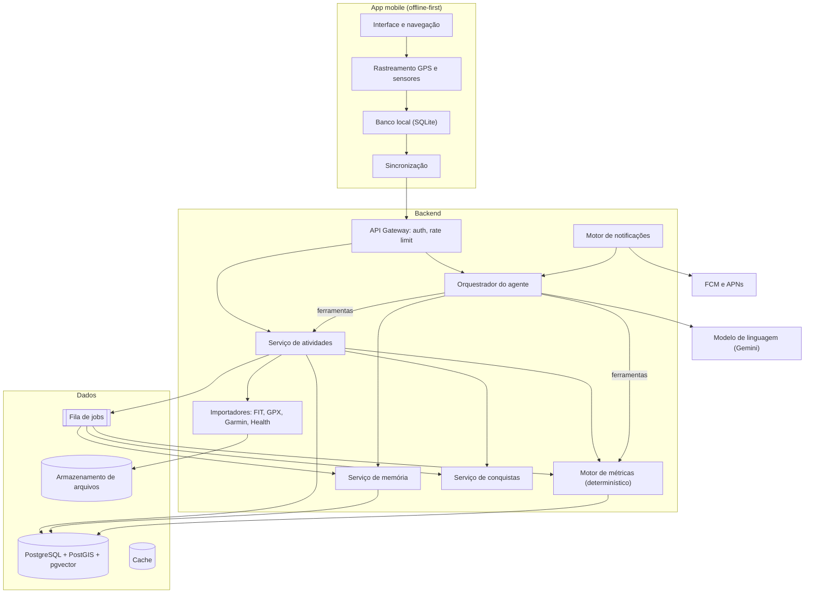
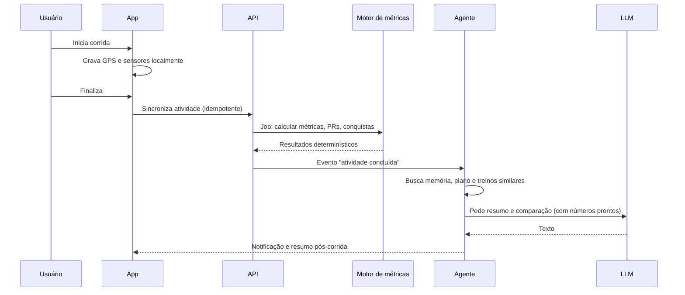
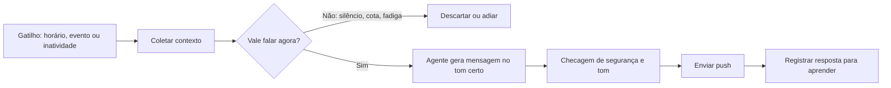
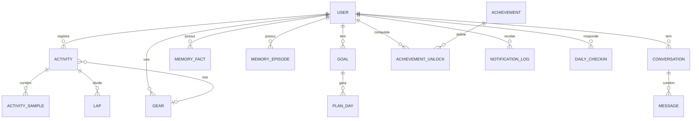

# Vybra: funções e arquitetura

> **Conceito:** um agente pessoal de IA que rastreia seus treinos como o Strava, lembra de você entre as conversas e te leva ao seu objetivo todos os dias. Sem feed e sem social: a comparação é sempre **você contra você**.

---

## 1. Funções do app

### 1.1 Rastreamento (paridade com o Strava)
| Função | Detalhe |
|---|---|
| Gravação por GPS | Corrida, caminhada, pedal, trilha. Pausa automática, serviço em segundo plano |
| Métricas ao vivo | Pace, distância, tempo, altimetria, cadência, FC (via sensor ou relógio) |
| Voz durante o treino | Parciais e dicas faladas pelo agente |
| Parciais e voltas | Splits por km, voltas manuais, intervalados estruturados |
| Altimetria | Perfil de elevação, ganho e perda acumulados, grade (%) |
| Zonas | Zonas de FC e de pace personalizadas |
| Recordes pessoais | Melhor 1k, 5k, 10k, 21k, 42k e mais longa |
| Segmentos privados | Você marca um trecho e compara só com suas passagens anteriores |
| Rotas | Criação, importação de GPX e exportação para relógio |
| Equipamentos | Tênis e bike com contagem de km e alerta de desgaste |
| Importação | `.fit`, `.gpx`, `.tcx`, Garmin, Apple Health, Health Connect |
| Treinos sem GPS | Esteira, força, yoga e caminhada de rotina, registro manual ou por sensor |

### 1.2 Comparação e análise
- **Você contra você:** compara qualquer corrida com outra, com o seu melhor, com a média das últimas 4 semanas ou com o mesmo percurso.
- **Explicação causal:** a IA diz **por que** a corrida foi diferente, cruzando sono, calor, carga da semana, FC e cadência.
- **Métricas derivadas:** eficiência aeróbica, deriva cardíaca, queda de ritmo no final, carga aguda e crônica, estimativa de VO2 e previsão de tempo para provas.
- **Tendências:** evolução por semana, mês e ano, com marcas de períodos de pausa e de lesão.

### 1.3 Agente pessoal (núcleo do produto)
- **Chat com memória persistente:** o agente lembra de você ao fechar e reabrir o app.
- **Check-in diário:** pergunta como você está e adapta o dia (treino forte, leve, descanso ou alternativa).
- **Dia difícil:** se você não conseguiu correr, ele acolhe, entende o motivo e propõe algo menor, como 10 minutos de caminhada ou alongamento. Nunca culpa.
- **Registro de vida:** você fala sobre trabalho, sono, humor, dificuldades, e isso vira contexto para o treino.
- **Diário e reflexão:** resumo semanal sobre treino e momento de vida.
- **Planos de objetivo:** prova-alvo, perda de peso, volta após lesão, hábito. O plano se reescreve com o que você realmente cumpriu.
- **Apoio emocional leve:** escuta, motivação e técnicas simples (respiração, reenquadramento). Não substitui terapia.

### 1.4 Notificações proativas
- Decididas pelo agente, não por horário fixo: considera rotina, sono, clima e histórico de resposta.
- Tipos: lembrete de treino, incentivo, aviso de recuperação, celebração de conquista, check-in de humor.
- Controles: horário de silêncio, limite diário e modo "me deixe em paz hoje".

### 1.5 Conquistas
- **Consistência:** semanas seguidas, retorno após pausa (descanso programado não quebra a sequência).
- **Evolução:** recordes, melhora de eficiência, negative split.
- **Marcos:** 100, 500 e 1.000 km, Everest em altimetria acumulada.
- **Exploração:** rotas novas, cidades diferentes.
- **Inteligência:** "ouviu o corpo", cumpriu plano acima de 90%.
- **Personalizadas:** a IA cria desafios sob medida a partir do seu histórico.

### 1.6 Dados e privacidade
- Exportação completa e exclusão total da conta e da memória.
- Tela "O que o Vybra sabe sobre mim": ver, editar e apagar cada memória.
- Zonas de ocultação (casa e trabalho).
- Biometria ou PIN para abrir o app, pois o conteúdo é sensível.

---

## 2. Arquitetura

### 2.1 Visão geral

### 2.2 Princípios
1. **Offline-first:** a gravação nunca depende de rede. O treino salva localmente e sincroniza depois.
2. **Cálculo é código, não LLM:** pace, zonas, carga e recordes vêm do motor determinístico e testável. O LLM só interpreta e explica números já calculados.
3. **O agente age por ferramentas:** consulta atividades, métricas, plano e memória por function calling, sem receber o banco inteiro no prompt.
4. **Memória estruturada, não histórico bruto:** ver seção 3.
5. **Dado sensível por padrão:** tratamento de saúde e emoção sob LGPD, com consentimento explícito.

### 2.3 Stack sugerida (adaptável)
| Camada | Escolha | Motivo |
|---|---|---|
| App | Flutter | Um código para Android e iOS, bom acesso a GPS, sensores e execução em segundo plano |
| Local | SQLite (Drift) | Gravação offline robusta |
| API | TypeScript (NestJS) ou Python (FastAPI) | Contratos tipados e ecossistema para dados |
| Banco | PostgreSQL + PostGIS + pgvector | Dados relacionais, geografia (rotas e segmentos) e busca semântica da memória |
| Fila | Redis com workers (BullMQ ou Celery) | Processamento assíncrono de métricas, conquistas e memória |
| Arquivos | Armazenamento de objetos (GCS ou S3) | Arquivos `.fit` e `.gpx` originais |
| IA | Gemini API com function calling | Chat, resumos e extração de memória |
| Push | FCM e APNs | Notificações |
| Observabilidade | OpenTelemetry, logs sem PII | Rastreio e SLOs |

### 2.4 Fluxo de um treino

### 2.5 Fluxo de notificação proativa

---

## 3. Sistema de memória

O agente "conhece você de ponta a ponta" por camadas, não por um histórico gigante.

| Camada | O que guarda | Exemplo | Armazenamento |
|---|---|---|---|
| Trabalho | Conversa atual | Últimas mensagens | Contexto da sessão |
| Episódica | Resumos de conversas e dias | "Terça: dormiu mal, correu 4 km devagar" | Texto + embeddings (pgvector) |
| Semântica | Fatos estáveis sobre você | "Trabalha em turnos", "joelho direito sensível" | Tabela de fatos com fonte e data |
| Perfil | Objetivos, preferências, tom desejado | "Prova de 10k em março", "prefere tom direto" | Registro estruturado |
| Padrões | O que o agente aprendeu | "Rende pior após noites de menos de 6h" | Calculado pelo motor de métricas |

**Pipeline de memória**
1. Ao fim de cada conversa, um job extrai fatos novos, mudanças de objetivo e emoções relevantes.
2. Cada fato recebe confiança, origem e data. Fatos contraditórios substituem os antigos, sem duplicar.
3. Antes de responder, o agente busca por relevância e recência, e monta um contexto curto.
4. Você pode ver, corrigir e apagar qualquer item. Apagar remove também dos embeddings.

> [!IMPORTANT]
> Conteúdo emocional recebe sensibilidade maior: retenção configurável, sem uso para qualquer outra finalidade e sem treino de modelos com os seus dados.

---

## 4. Agente: comportamento e proteção

**Ferramentas disponíveis ao agente**
`buscar_atividades`, `comparar_atividades`, `ler_metricas`, `ler_plano`, `atualizar_plano`, `buscar_memoria`, `salvar_memoria`, `agendar_lembrete`, `ver_recuperacao`.

**Regras de comportamento**
- Nunca culpar ou comparar com outras pessoas.
- Se você não correu, o foco é entender e ajustar, não cobrar.
- Não faz diagnóstico médico nem psicológico. Orienta a procurar profissional quando houver dor persistente ou sofrimento.
- Os números que cita vêm sempre das ferramentas. Sem dado, ele diz que não sabe.

**Protocolo de crise**
- Detecta sinais como menção a autolesão ou desesperança grave.
- Interrompe o tom motivacional, acolhe e indica o CVV (188) e o SAMU (192).
- Pausa as notificações de treino e registra o evento como sensível.
- Esse fluxo é testado com casos de avaliação antes de cada release.

---

## 5. Modelo de dados (resumo)

Pontos de atenção do modelo:
- `ACTIVITY_SAMPLE` guarda a série (tempo, lat/lon, altitude, FC, cadência) e usa particionamento ou armazenamento colunar compactado.
- `MEMORY_FACT` guarda `valor`, `confianca`, `origem`, `criado_em`, `substitui_id`, `sensivel`.
- Toda tabela de usuário tem isolamento por `user_id` com RLS no PostgreSQL.
- `ACTIVITY` tem chave de idempotência por dispositivo para evitar duplicatas na sincronização.

---

## 6. Segurança, privacidade e LGPD

| Tema | Controle |
|---|---|
| Autenticação | OAuth (Google e Apple), tokens de curta duração, refresh rotativo |
| Autorização | Isolamento por usuário na API e RLS no banco; sem acesso entre contas |
| Criptografia | TLS em trânsito, criptografia em repouso e campos sensíveis (memória emocional) cifrados |
| Localização | Zonas de ocultação, sem compartilhamento externo |
| Consentimento | Separado para saúde, localização, memória emocional e notificações |
| Direitos do titular | Exportação, correção e exclusão completa, inclusive embeddings |
| IA | Sem treino com dados do usuário, redação de PII em logs, prompts versionados |
| Abuso | Rate limit por usuário e dispositivo, limites de tamanho de upload, validação de arquivos `.fit` e `.gpx` |
| Prompt injection | Conteúdo importado (nomes de rota, notas) é tratado como dado, nunca como instrução |

---

## 7. Resiliência e operação

- **Timeouts e retry com backoff e jitter** em chamadas ao LLM e a integrações.
- **Degradação:** se o LLM cair, o app segue gravando, analisando (motor de métricas) e mostrando dados. O chat avisa a indisponibilidade em vez de falhar.
- **Jobs idempotentes** com fila de mensagens mortas (DLQ) e replay seguro.
- **Controle de custo:** cache de resumos, modelo menor para tarefas simples, orçamento de tokens por usuário.
- **SLOs sugeridos:** sincronização de atividade em até 99,9% de sucesso, resposta do agente com p95 abaixo de 6 s, entrega de push com taxa monitorada.
- **Backups:** só contam após restauração testada em ambiente isolado.

---

## 8. Roadmap

| Fase | Entrega | Prazo estimado |
|---|---|---|
| **0. Fundação** | Contas, banco, CI, design system, política de privacidade | 2 a 3 semanas |
| **1. MVP** | Gravação GPS offline, histórico, pace, parciais, altimetria, mapa, importação `.fit` e `.gpx` | 6 a 8 semanas |
| **2. Agente** | Chat com memória, check-in diário, resumo pós-corrida, comparação entre corridas | 6 a 8 semanas |
| **3. Engajamento** | Notificações proativas, conquistas, plano de objetivo adaptativo, dia difícil | 4 a 6 semanas |
| **4. Profundidade** | Previsão de provas, carga e recuperação, Garmin e Health Connect, equipamentos, segmentos privados | 6 semanas |
| **5. Maturidade** | Voz durante o treino, relatório semanal, alertas de risco de lesão, wearables | contínuo |

**Critérios do MVP:** gravar 1 hora de corrida sem perda de dados com o app em segundo plano e a tela bloqueada, abrir o histórico offline e importar um `.fit` real com métricas conferidas contra uma referência.

---

## 9. Riscos e decisões em aberto

| Risco | Mitigação |
|---|---|
| GPS em segundo plano varia por fabricante (Android) | Serviço em primeiro plano, testes em vários aparelhos, orientação de bateria ao usuário |
| Custo do LLM com memória | Contexto curto, cache, modelos escalonados, orçamento por usuário |
| Dependência emocional ou conselho inadequado | Limites claros, protocolo de crise, avisos, avaliação contínua |
| Termos do Strava e de dados de terceiros | Priorizar arquivos e Health Connect, tratar Strava como opcional |
| Marca "Vybra" | Verificar INPI, domínio e lojas antes de investir em identidade |
| Retenção de dado sensível | Retenção configurável, minimização e exclusão real |

**Decisões que dependem de você**
1. Plataforma inicial: Android, iOS ou ambos?
2. Foco esportivo inicial: só corrida ou também pedal e caminhada?
3. Modelo de receita: assinatura, gratuito com limites ou pago único?
4. Voz do agente: tom direto, acolhedor ou ajustável?
5. Posso iniciar o protótipo do MVP? Sugiro começar pelo app e pelo motor de métricas, e ligar a IA na fase 2.
